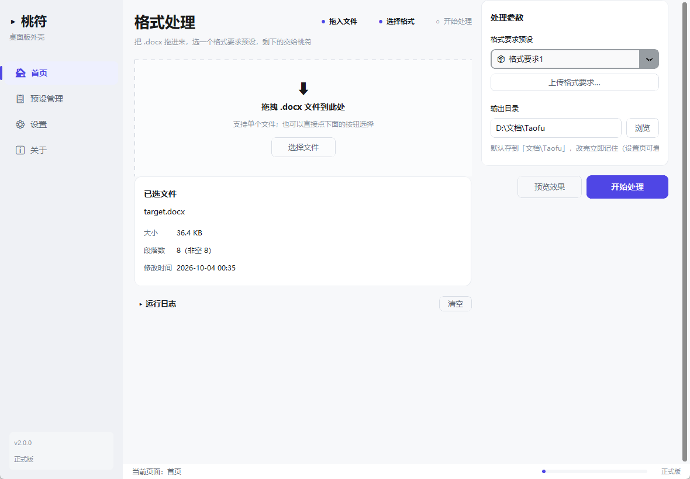
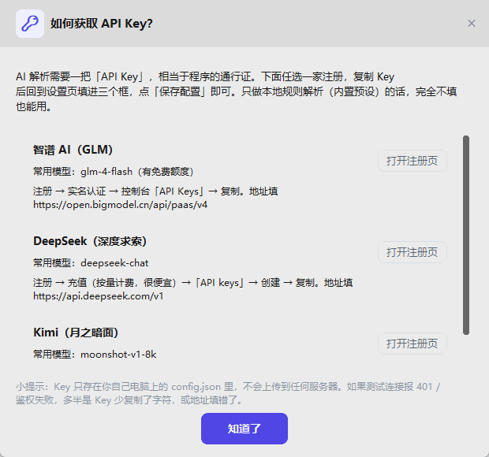

# 桃符（Taofu）

**把一份 Word 文档按「格式要求」重新排版，正文一个字都不改动。**

拖进去 → 选一个格式要求 → 点开始 → 得到一份排好版的新文档。
Windows 10 / 11 上双击即用，不需要安装 Python，也不需要联网（AI 解析除外）。

---

## 目录

- [它适合谁](#它适合谁)
- [下载与安装](#下载与安装)
- [第一次使用：四个步骤](#第一次使用四个步骤)
- [需要 AI 解析？申请一个 API Key（可选）](#需要-ai-解析申请一个-api-key可选)
- [文件都保存在哪](#文件都保存在哪)
- [常见问题](#常见问题)
- [已知限制](#已知限制)
- [许可证](#许可证)

---

## 它适合谁

- 论文、报告：学校/期刊给了格式要求，正文几百段要逐个改字体字号；
- 单位公文：标题层级、行距、首行缩进、页边距都得统一；
- 一批文档要套同一套模版，手动改到崩溃。

桃符做的事很单纯：**只改格式，不改文字**。处理完会生成一份新的
`原文件名_formatted.docx`，同时留一份 `原文件名_formatted.report.json`
记录每一段到底改了什么，方便你核对。**原始文件永远不会被覆盖。**

内置了三套常用格式要求：

| 预设 | 风格 |
| --- | --- |
| 格式要求1 | 中文公文风：宋体/黑体、1.5 倍行距、首行缩进 2 字符，附带清理多余空行 |
| 格式要求2 | 屏幕阅读风：微软雅黑、1.15 倍行距、无缩进（`.docx` 样式模板） |
| 格式要求3 | 学位论文（GB/T 7713.1-2025 + GB/T 7714-2015） |

---

## 下载与安装

1. 打开本项目的 **Releases** 页面，下载最新版本的 Windows 压缩包
   （文件名形如 `桃符-v2.0.0-win64.zip`）；
2. 解压到一个**普通文件夹**，例如 `D:\软件\桃符\`
   （不要放在 `C:\Program Files\`，那里普通权限写不了文件）；
3. 双击里面的 **`桃符.exe`** 就能用。

首次启动会慢 3～5 秒，之后正常。**没有安装程序，也没有卸载程序**——
整个文件夹就是一个完整的程序。

> ⚠️ 不要只把 `桃符.exe` 单独拷走。它需要同目录下的 `_internal\` 和 `presets\`，
> 移动时请移动**整个文件夹**。

---

## 第一次使用：四个步骤

1. **把 `.docx` 拖进窗口** —— 拖不动就点「选择文件」，效果一样。
2. **选一个格式要求** —— 下拉框里带 📦 的是内置预设，带 👤 的是你自己存的。
3. **（建议）点「预览效果」** —— 弹窗会显示识别到的标题结构、每一类段落将套用的
   字体字号、以及前几段的实际效果。预览不会动你的输出目录。
4. **点「开始处理」** —— 生成的文件放在右侧「输出目录」里
   （默认是 `我的文档\Taofu\`）。

想用自己的格式要求：点 **「上传格式要求」** → 粘贴一段中文要求（或选 `.txt` /
`.docx` 文件）→ 软件把它转成排版规则 → 确认后存成「用户预设」，下次直接选。

> 只用内置预设时，**完全不需要配置 API Key**，也不会有任何联网行为。

---

## 需要 AI 解析？申请一个 API Key（可选）

只有当你上传**自己的中文格式要求**、需要软件把自然语言翻译成排版规则时，
才需要一把 API Key。三家平台任选一家即可（价格与免费额度以各自官网为准）。

### 第一步：注册并创建 Key

| 平台 | 注册地址 | 常用模型 | 说明 |
| --- | --- | --- | --- |
| **智谱 AI（GLM）** | <https://open.bigmodel.cn/> | `glm-4-flash` | 有免费额度，适合只想试试的人 |
| **DeepSeek** | <https://platform.deepseek.com/> | `deepseek-chat` | 按量计费，一次解析不到一分钱 |
| **Kimi（月之暗面）** | <https://platform.moonshot.cn/> | `moonshot-v1-8k` | 国内直连，速度快 |

以智谱为例（另外两家流程几乎一样）：

1. 打开注册页，用手机号注册并登录；
2. 按提示完成实名认证（国家要求，只需一次）；
3. 进入控制台，找到 **「API Keys」**（有的平台叫「API Key 管理」）；
4. 点 **「新建 / 创建 API Key」**，复制那串以 `sk-` 开头的字符——**只显示一次**，
   先粘贴到记事本里备好。

### 第二步：填进软件

打开软件左侧的 **「设置」**，在「API 配置」卡片里填三项，然后点 **「保存配置」**：

| 输入框 | 填什么（按你选的平台） |
| --- | --- |
| **API 地址（Base URL）** | 智谱 `https://open.bigmodel.cn/api/paas/v4` · DeepSeek `https://api.deepseek.com/v1` · Kimi `https://api.moonshot.cn/v1` |
| **API 密钥（API Key）** | 刚才复制的 `sk-……` 那一长串（输入框默认打码，点「显示」可核对） |
| **模型名称（Model）** | 智谱 `glm-4-flash` · DeepSeek `deepseek-chat` · Kimi `moonshot-v1-8k` |

保存后点 **「测试 API 连接」**：显示「连接成功 · 986 ms」就说明配好了。
配置保存在本机，**重启软件后依然生效**。

设置页里还有一个 **「如何获取 API Key？」** 按钮，随时可以点开看这几家的申请步骤：

> 🔒 这把 Key 只保存在你自己的电脑上（`%APPDATA%\Taofu\config.json`），
> 不会上传到任何地方，也不会写进日志。分享截图时记得别把 Key 一起截进去。

---

## 文件都保存在哪

| 内容 | 位置 | 卸载时 |
| --- | --- | --- |
| 程序本体 | 你解压出来的那个文件夹 | 直接删掉文件夹 |
| 内置格式要求 | 程序文件夹里的 `presets\` | 随文件夹删 |
| **你的设置与 API 配置** | `%APPDATA%\Taofu\config.json` | **手动删** |
| **你保存的格式要求** | `%APPDATA%\Taofu\presets\` | **手动删** |
| Token 用量统计 | `%APPDATA%\Taofu\usage.json` | **手动删** |
| 处理结果 | 首页「输出目录」，默认 `我的文档\Taofu\` | 你自己决定 |

一句话记住：

- 程序文件夹 = 程序本身（只读，别去改）；
- `%APPDATA%\Taofu\` = 软件替你记的东西（换版本、换位置都不会丢）；
- 想彻底清理：删掉程序文件夹 + 删掉 `%APPDATA%\Taofu\`。

没有注册表项，没有后台服务，没有开机自启。

---

## 常见问题

**双击后没反应 / Windows 提示「已保护你的电脑」**
新程序没有购买数字签名，这是 Windows SmartScreen 的常规提示。
点「更多信息」→「仍要运行」即可。

**杀毒软件报毒，或 exe 被删掉了**
打包工具（PyInstaller）的产物经常被误报，这是行业通病，不是软件真有毒。
把整个 `桃符` 文件夹加入杀毒软件的信任区/白名单；如果公司电脑有防火墙策略，
可能需要让网络管理放行 `桃符.exe` 的出站连接——只有「AI 解析」和「测试连接」会联网，
其它功能全程离线。

**拖拽没反应**
某些系统权限或远程桌面环境会禁用文件拖放。直接点「选择文件」，
功能完全一样。

**提示「找不到预设」**
只拷了 exe 出来。请把整个文件夹一起复制（`presets\` 和 `_internal\` 必须同行）。

**「测试 API 连接」失败**
按提示顺序排查：

- `401 / Unauthorized`：Key 复制少了几位，或复制时多了空格；
- `404 / model not found`：模型名称拼错，或 API 地址和平台不是一家；
- `连接超时`：检查网络/代理，或换一家平台试试；
- 什么都不填：三项必须**全部**填好才能保存。

**处理完了，但没找到输出文件**
看首页「运行日志」最后几行写的完整路径，文件名是 `原文件名_formatted.docx`，
旁边的 `.report.json` 记录了逐段改动明细。

**处理结果不满意 / 文字被改了？**
桃符只改格式，且会校验「文字没有变化」；如果某段落到不了指定格式，会写进报告里
而不是硬改。把 `.report.json` 一起反馈，能大幅加快定位。

**如何反馈 Bug**
到本项目的 **Issues** 页面新建一条，请附上：

1. 你用的版本（关于页可见，如 v2.0.0）；
2. 一段能复现问题的样例文档（可以把敏感内容替换掉）；
3. 首页「运行日志」里的相关几行 + 生成的 `.report.json`；
4. 现象描述（期望什么、实际什么）。

⚠️ **不要把 API Key 贴进 Issue**。

---

## 已知限制

- 只支持 `.docx`。`.doc`（老格式）请先用 Word 另存为 `.docx`。
- 页眉、页脚、脚注、文本框里的内容不套用格式规则（保持原样），也不参与文本清理。
- 文本格式要求里写的「页边距 / 纸张方向」不会真的改页面设置；需要改页面时，
  用已设好页面的 `.docx` 作为样式模板，或在 Word 里手动设置。
- 悬挂缩进只对「列表」角色生效。
- 文本清理会重写被清理段落的文字块，段内局部的加粗/颜色会被统一后重新套用。
- 自动目录等「域」里的文字可能识别不到，会在报告的 `unresolved` 里提示。

---

## 许可证

[MIT License](LICENSE) —— 可自由使用、修改、商用，请保留版权声明。

想自己从源码构建或参与开发：打包脚本是 `desktop\Taofu.spec` +
`desktop\build.bat`，核心引擎在 `src\word_format_applier\`，界面在 `desktop\`。
