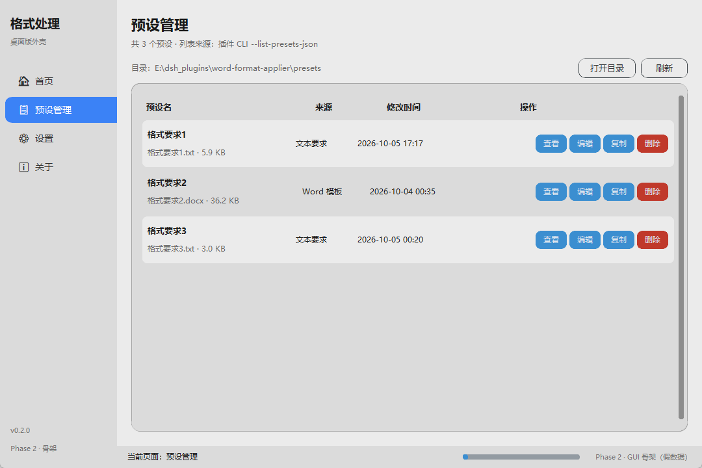
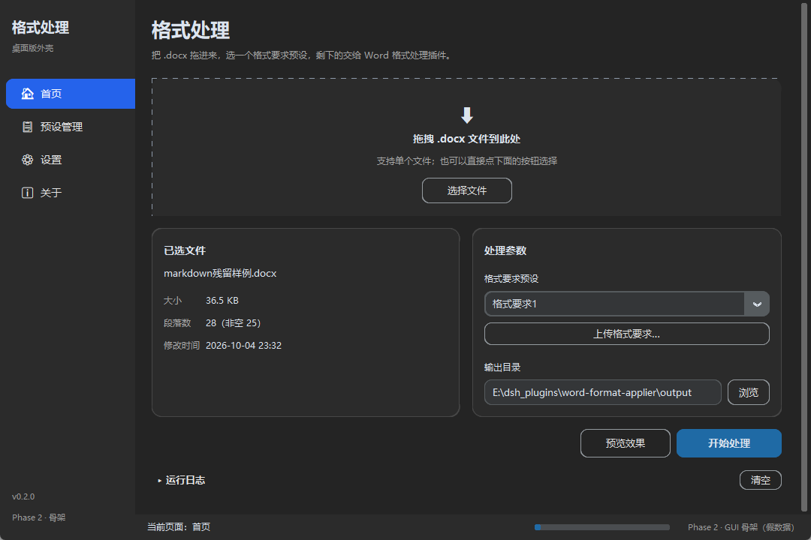
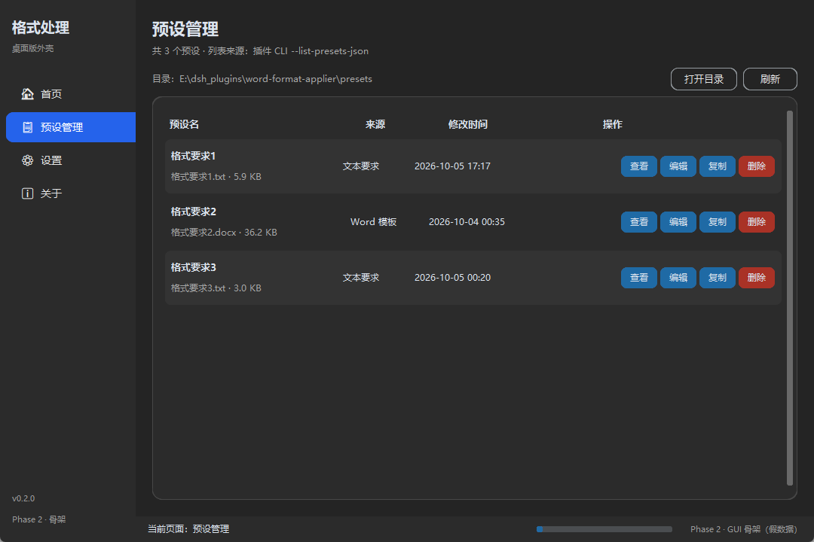
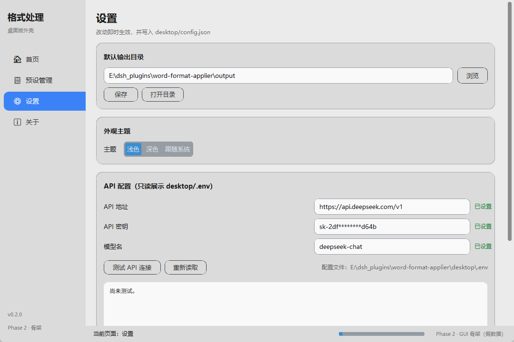
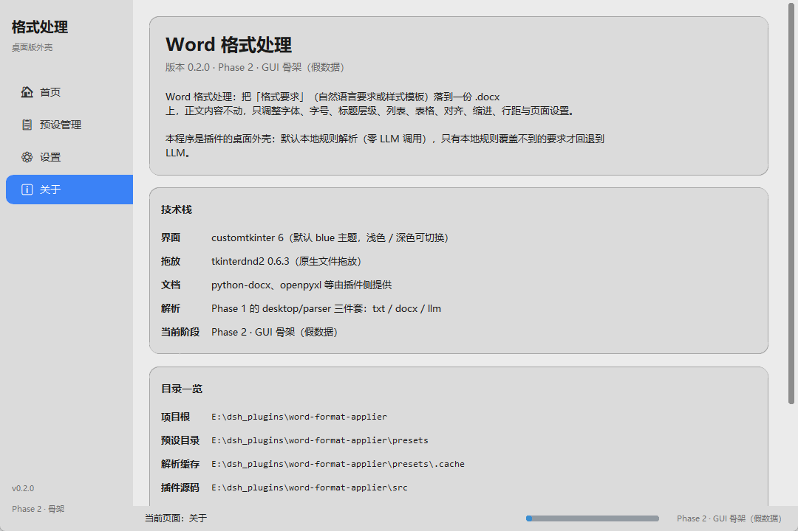
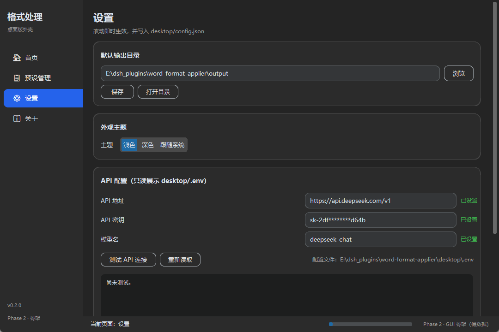
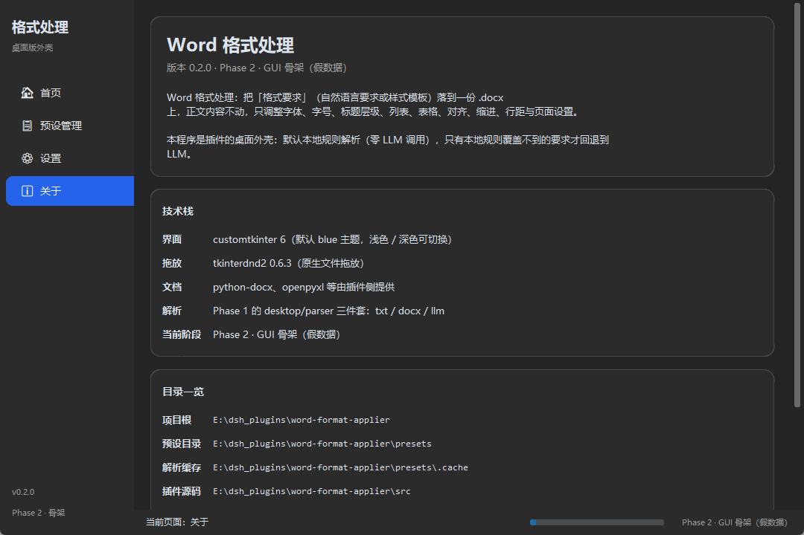

# Word 格式助手（WordFormatAssistant）

把 `.docx` 按**格式要求**（字体、字号、标题级别、段落缩进、行距、页边距…）批量重排的
**Windows 桌面工具**。绿色免安装，目标机器**不需要装 Python**；
默认走本地规则解析，**零 LLM 调用**，文档不上传。

> 原始文件永远不被改写——输出是新的 `<原名>_formatted.docx` 加一份 `.report.json`。

---

## 截图

| 首页 | 预设管理 |
| --- | --- |
|  |  |
|  |  |

| 设置 | 关于 |
| --- | --- |
|  |  |
|  |  |

---

## 一、安装：不用安装

1. 拿到打包好的 `Word格式助手` 文件夹（或自己构建，见第六节）；
2. 双击里面的 **`Word格式助手.exe`**；
3. 首次启动慢 3～5 秒（onedir 要先解包 bootloader），之后正常。

* 不弹黑窗，启动后直接是窗口。
* SmartScreen 提示「已保护你的电脑」→「更多信息」→「仍要运行」。
* **不要只把 exe 拷出去**：它依赖同目录的 `_internal\`、`presets\`、`.env`，
  移动就整个文件夹一起移。

---

## 二、快速上手（四步）

1. **拖 `.docx` 进窗口** —— 拖不动就点拖拽区选文件（拖放不可用时自动降级）。
   界面会显示文件名、大小、段落数、修改时间。
2. **选预设** —— 下拉框里 `📦` 是内置预设，`👤` 是你自己保存的用户预设。
3. **预览效果**（建议先看）—— 弹窗三段：识别的标题结构 / 预设的角色映射 /
   前 3 段的实际格式。预览在临时目录里真跑一遍，**不会**动你的输出目录。
4. **开始处理** —— 生成 `<原名>_formatted.docx` 到「输出目录」
   （首页可改，默认 `我的文档\WordFormatAssistant\`），同时落一份 `.report.json`。

想用自己的格式要求：**上传格式要求** → 粘贴文字 / 选 `.txt` / 选 `.docx`
→ 出 DSL → 确认使用 → 存成用户预设，下次直接在下拉框里选。

---

## 三、两条解析路线

| 路线 | 需要 API | 说明 |
| --- | --- | --- |
| **本地规则解析** | 不需要 | 内置预设（格式要求1/2/3）或自己贴 DSL，全程离线 |
| **上传格式要求，AI 转规则** | 需要 | 粘贴/上传一段中文格式要求，AI 译成 DSL |

只用前者的话，本节可以跳过。

配置方式（二选一，**环境变量优先于 `.env`**）：

```ini
# 放在 exe 同级、改名成 .env（模板见 .env.example）
OPENAI_BASE_URL=https://api.deepseek.com/v1
OPENAI_API_KEY=sk-你的key
OPENAI_MODEL=deepseek-chat
```

改完重启程序，进 **设置 → 测试 API 连接**，显示往返延迟即成功。
设置页「配置文件」一行显示程序实际读取的 `.env` 路径，对不上看那一行。

> `.env` 里是明文密钥，别连文件夹一起发给别人；本仓库的 `.gitignore` 已忽略 `.env`。

---

## 四、文件都存哪

| 内容 | 位置 | 卸载时 |
| --- | --- | --- |
| 内置预设 | **优先** exe 同级 `presets\`，没有就用 `_internal\presets\` | 随文件夹删 |
| 解析缓存 | 上面那个被选中的 `presets\.cache\` | 随文件夹删，删了自动重建 |
| API 配置 `.env` | exe 同级（模板 `.env.example` 也在那儿） | 随文件夹删 |
| **用户配置** | `%APPDATA%\WordFormatAssistant\config.json` | **手动删** |
| **用户预设** | `%APPDATA%\WordFormatAssistant\presets\` | **手动删** |
| Token 统计 | `%APPDATA%\WordFormatAssistant\usage.json` | **手动删** |
| 处理输出 | 首页「输出目录」（默认 `我的文档\WordFormatAssistant\`） | 自己决定 |

一句话记住：`_internal\` 是程序的肚子（只读、别管）；
exe 同级放**你要改的东西**（`.env`、自定义 `presets\`）；
`%APPDATA%\WordFormatAssistant\` 放**程序替你记的东西**（配置 / 预设 / 统计），
换版本、换位置都不会丢。

卸载 = 删掉整个程序文件夹 + 手动清 `%APPDATA%\WordFormatAssistant\`。
没有注册表项、没有服务、没有开机自启。

---

## 五、内置预设

| 预设 | 风格 |
| --- | --- |
| `格式要求1.txt` | 中文公文风 + 文本清理（含删空段落）+ 结构预处理：宋体/黑体、1.5 倍行距、首行缩进 2 字符 |
| `格式要求2.docx` | 屏读风：微软雅黑、1.15 倍行距、无缩进（`.docx` 样式模板） |
| `格式要求3.txt` | 学位论文（GB/T 7713.1-2025 + GB/T 7714-2015）+ 空白/标点/空段落清理 |

预设就是「丢文件即生效」：在 exe 同级建 `presets\` 放自己的 `.txt` / `.md` /
`.docx`，程序会优先用它；删掉该目录即恢复默认。

---

## 六、从源码构建（开发者）

```bat
:: 依赖
.venv\Scripts\python.exe -m pip install -r requirements.txt -r desktop\requirements.txt

:: 开发期直接跑 GUI
.venv\Scripts\python.exe desktop\app.py

:: 打包成 exe（onedir + windowed）
cd desktop
build.bat
```

`build.bat` 会检查/安装 PyInstaller，按 `desktop\WordFormatAssistant.spec` 打包到
`desktop\dist\Word格式助手\`，并把 `.env.example` 复制到 **exe 同级**。
改了 `src/` 或 `presets/` **不需要**动 spec，重新打包即可带上新内容。

**路径归属（改代码前先看）**：用户可见路径一律由 `sys.executable`（frozen）
或 `__file__`（开发期）推出，见 `desktop/core/config.py`：

| 常量 | 含义 | 打包后 |
| --- | --- | --- |
| `APP_DIR` | 程序目录 | exe 所在目录 |
| `ENV_PATH` | 实际读到的 `.env` | `<exe>\.env`（回落 `_internal\.env`，再没有 = None） |
| `CONFIG_PATH` | `config.json` | `%APPDATA%\WordFormatAssistant\config.json` |
| `PRESETS_DIR` | 内置预设 | `<exe>\presets` → `_internal\presets` |

> **绝不要用 `__file__` 推用户可见路径**——frozen 下它指向 `_internal\`。

打包后自测 CLI 通道（不开 GUI）：

```bat
dist\Word格式助手\Word格式助手.exe --wfa-cli --list-presets-json
```

---

## 七、命令行引擎（可选）

GUI 之外的固定流程，**0 token**：

```bash
# 列出所有预设
python -m word_format_applier --list-presets

# 用预设改格式
python -m word_format_applier --target 目标.docx --preset 格式要求1 --output 输出.docx

# 用 .docx 样式模板改格式
python -m word_format_applier --target 目标.docx --format ./samples/format.docx --output 输出.docx

# 直接用文本要求（能规则解析时不调 LLM）
python -m word_format_applier --target 目标.docx --format "标题1：黑体 三号 加粗 居中" --output 输出.docx

# 只看规则 / 只出报告 / 打印短 JSON
python -m word_format_applier --print-rules --preset 格式要求3
python -m word_format_applier --target 目标.docx --preset 格式要求1 --dry-run
python -m word_format_applier --target 目标.docx --preset 格式要求1 --json --pretty
```

Python API：

```python
from word_format_applier import apply_format
summary = apply_format("目标.docx", "preset:格式要求1", "输出.docx")
```

每日志/报告里的 `applied` / `skipped` / `llm_calls` / `text_unchanged`
就是这次改动的账本，`.report.json` 里有逐段明细。

---

## 八、项目结构

```
word-format-applier/
├── desktop/                    # 桌面应用（GUI 本体）
│   ├── app.py  dnd.py          # 主窗口 / 拖放
│   ├── core/                   # bridge（调 CLI）· config（路径）· preset_loader · user_presets
│   ├── parser/                 # docx 提取 · 文本 DSL 解析 · LLM 解析
│   ├── ui/                     # home / preview / preset_manager / settings / upload_dialog / about / theme
│   ├── build.bat  WordFormatAssistant.spec   # 打包
│   └── README.md               # 面向使用者的详细说明
├── src/word_format_applier/    # 核心引擎（GUI 与 CLI 共用）
│   ├── applier.py              # 清理 + 结构预处理 + 套用规则 + 文字不变校验
│   ├── textparse.py            # 文本规则解析 / .docx 样式模板抽取
│   ├── cleanup.py  structure.py# 可选文本清理 / 结构预处理
│   ├── parser.py  presets.py   # 统一解析入口（缓存 + LLM 兜底）/ 预设扫描
│   ├── docxio.py  schema.py  report.py  llm_fallback.py  cli.py
├── presets/                    # 内置预设（丢文件即生效）
├── samples/                    # 样例文档（target / format / markdown 残留样例）
├── screenshots/                # 本 README 的配图
├── tests/                      # 引擎单元测试
├── tools/                      # 冒烟脚本 · 样例生成 · GUI 截图/探针
└── docs/acl-fix.md             # 工作区 ACL 治理记录（环境类，与本功能无关）
```

---

## 九、测试

```powershell
.venv\Scripts\python.exe -m unittest discover -s tests -p "test_*.py"   # 引擎单元测试
.venv\Scripts\python.exe tools\smoke_cli.py                             # CLI 端到端
.venv\Scripts\python.exe tools\make_samples.py                          # 重新生成 presets/ 与 samples/
.venv\Scripts\python.exe tools\gui_shot.py                              # 重出 screenshots/ 里的截图
```

覆盖范围：字体/字号/行距/首行缩进/标题样式确实改动且文字不变、页边距生效、
文本要求解析、预设名解析与缓存命中、默认路径 0 次 LLM、dry-run 不覆盖原文件；
文本清理的每一类（markdown 残留、不可见字符、重复标点、空白、装饰符号、空段落）；
结构预处理的编号判级（公文 / 小数两套体系）、整段加粗识别、各类安全阀。

---

## 十、常见问题

**杀毒报毒 / exe 被删**
PyInstaller 产物的行业常态。把整个 `Word格式助手` 文件夹加进信任区。
本程序不联网上传任何文档，只有你主动点 AI 解析时才把**格式要求文字**发给
`.env` 里配置的那家 API。

**双击没反应 / SmartScreen 拦截**
点「更多信息」→「仍要运行」；仍不行就右键以管理员身份运行一次。

**拖拽没反应**
日志区会写「拖放能力：不可用（降级为点击选择）」——直接点选文件，功能一样。

**提示找不到预设**
只拷了 exe 出来。`presets\` 和 `_internal\` 要跟着一起拷。

**设置页 API 显示「(未设置)」**
`.env` 放错地方了：新版读 **exe 同级**（不是 `_internal\`）。看设置页
「配置文件」那行显示的路径。懒得建文件就设三个环境变量，它们优先级最高。

**处理完没看到输出**
看首页日志最后几行给的路径，以及同目录的 `*.report.json`。

更多细节见 [desktop/README.md](desktop/README.md)。

---

## 十一、限制

* 页眉/页脚、脚注、文本框内的格式规则暂不套用（保留原样），文本清理也不作用于这些位置。
* 文本预设里的「页边距 / 横纵向」**不会**应用到文档节（解析器写进了 `styles.normal`，
  而 applier 只从 `rules["page"]` 取页面规则）。要真正改页面，请用已设好页面设置的
  `.docx` 样式模板，或在 Word 里手动设置；行距不受影响。
* 悬挂缩进只对「列表」角色生效；参考文献条目必须命中列表样式才会拿到悬挂缩进。
* 文本清理只重写 `python-docx` 可见的 `w:r` run，`w:hyperlink` 内的文字不参与。
* 「编号正则」判级是启发式：开启后行首编号一律保留并按编号判级。
* 一段文字只要被清理改动，就会合并进该段第一个 run，段内原有的局部加粗/颜色会被放弃
  （随后按角色统一样式重新套用）。
* 域代码（如自动目录）内部的 run 可能不带文字，这类段落会在 `unresolved` 中提示。
* `.doc`（旧二进制格式）不支持，请先另存为 `.docx`。
* LLM 兜底需要 `WORD_FORMAT_LLM_API_KEY` 或 `DEEPSEEK_API_KEY`；未配置时自动跳过并继续本地流程。

---

## 十二、许可证

MIT License。

---

## 附：Token 策略

| 项 | 值 |
| --- | --- |
| 默认 LLM 调用 | **0** |
| LLM 调用上限 | 2 次 |
| 单次 `max_tokens` | 2000 |
| 发送内容 | 格式要求原文、去重后的样式摘要、目标文档样式统计、少量段落元数据 |
| 绝不发送 | 目标文档全文、XML 全文、完整 diff、完整日志 |
| 缓存 | 解析结果按文件哈希 + 规则版本缓存（`presets/.cache/`） |

失败处理：本地重试一次（lenient 解析）；仍失败则写出 `partial: true` 报告并返回报告路径，
不反复试错、不跳过文字不变校验、不编造格式。
